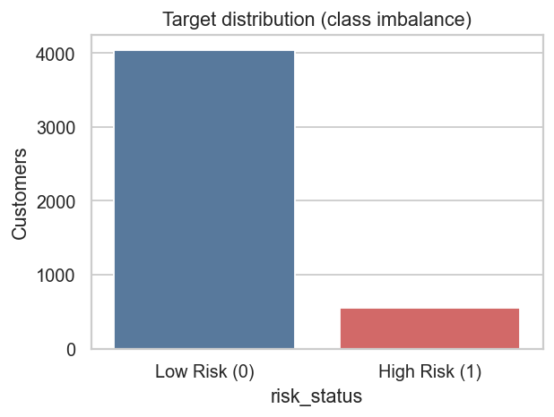
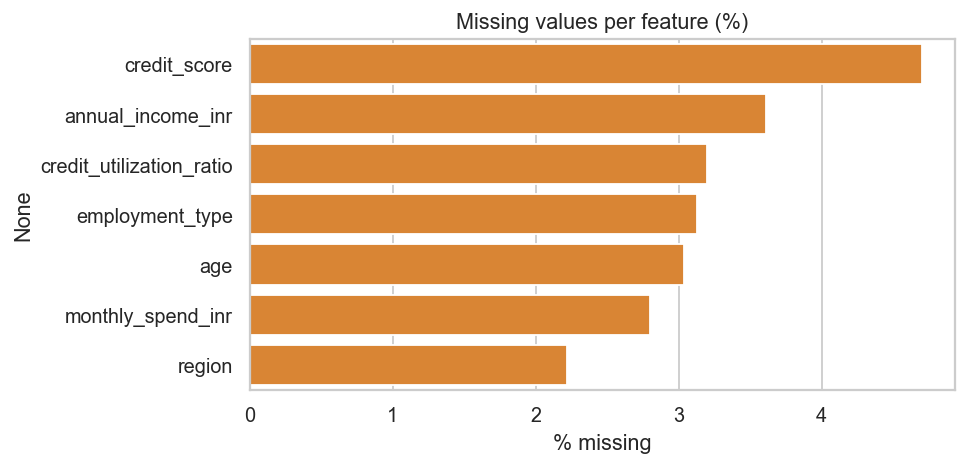
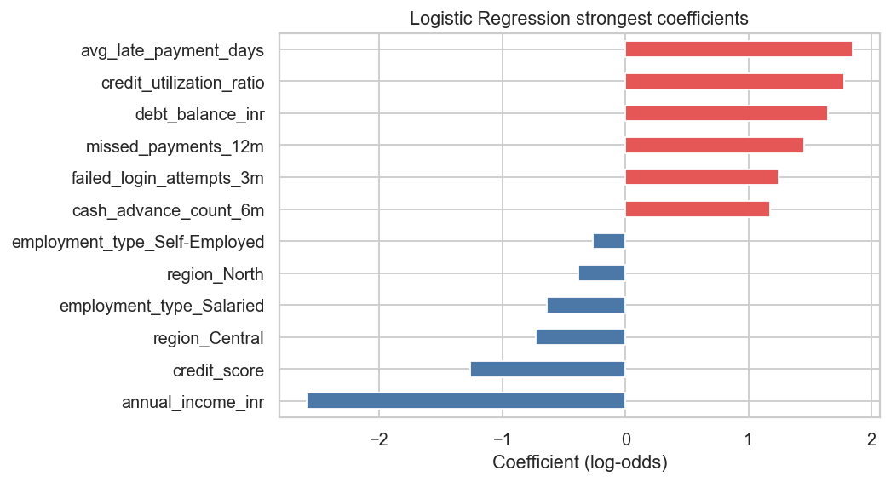
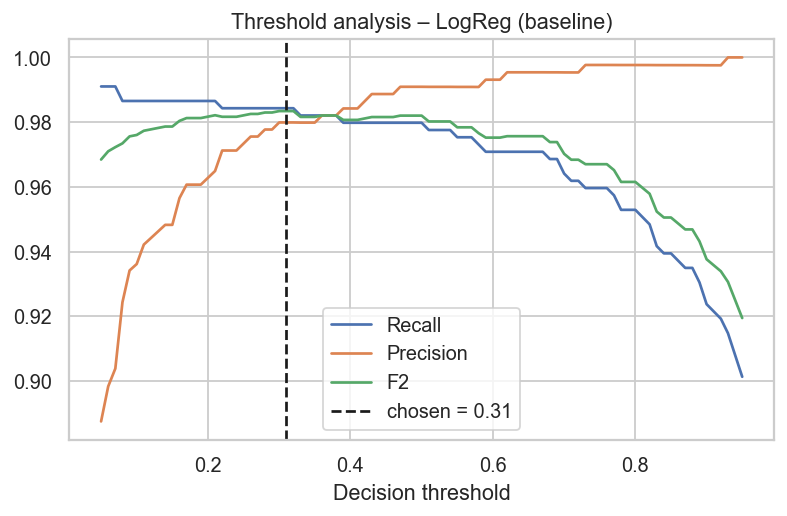
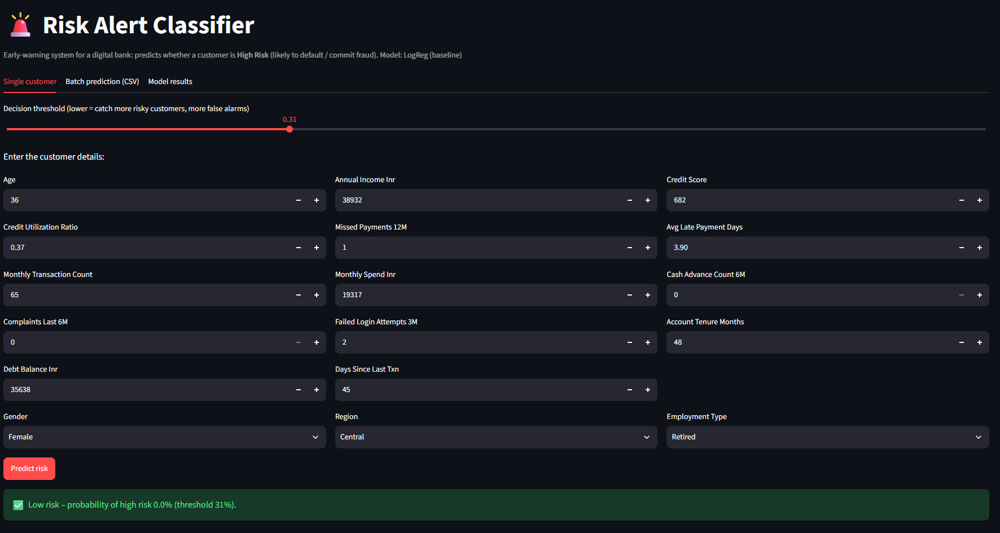
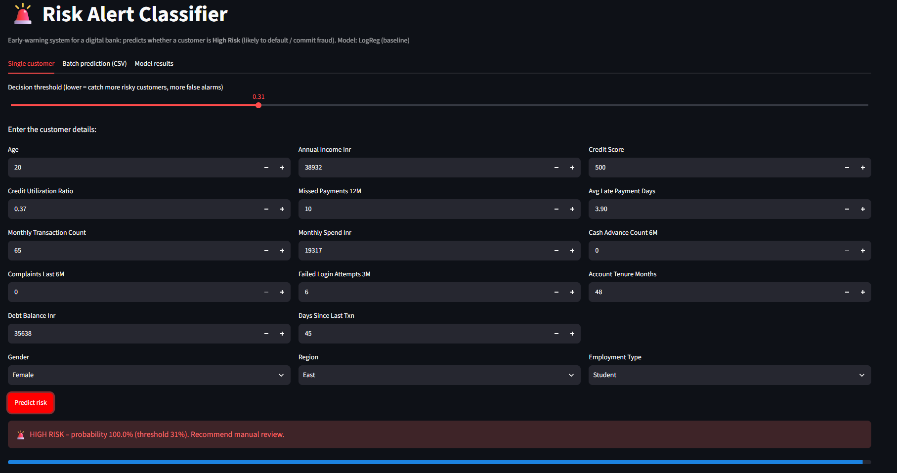
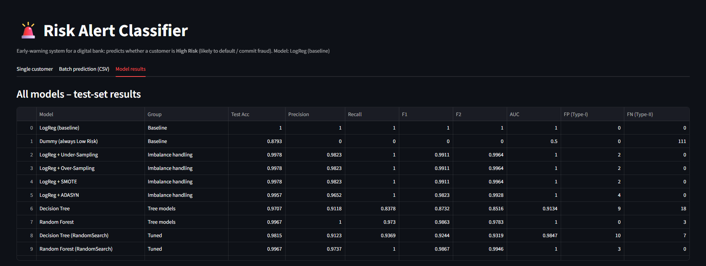

<div align="center">

# 🚨 Risk Alert Classifier

### Early-warning system to detect **high-risk bank customers** before the loss happens


**Recall = 1.00 &nbsp;•&nbsp; Precision = 1.00 &nbsp;•&nbsp; AUC = 1.00 &nbsp;•&nbsp; 0 False Negatives**

</div>

---

## 📌 Table of Contents

- [Overview](#-overview)
- [Key Highlights](#-key-highlights)
- [Dataset](#-dataset)
- [Project Pipeline](#-project-pipeline)
- [Exploratory Analysis & Preparation](#-exploratory-analysis--preparation)
- [Modelling](#-modelling)
- [Handling Imbalanced Data](#-handling-imbalanced-data)
- [Tree-Based Models & Tuning](#-tree-based-models--hyperparameter-tuning)
- [Model Evaluation & Final Model](#-model-evaluation--final-model)
- [Streamlit App](#-streamlit-app)
- [Project Structure](#-project-structure)
- [How to Run](#-how-to-run)
- [Business Recommendations](#-business-recommendations)
- [Limitations](#-limitations)
- [Author](#-author)

---

## 🎯 Overview

A digital bank wants to identify customers who are likely to **default on payments or commit fraud** *before* the loss happens.

The challenge: only about **12%** of customers are risky. A model judged only by accuracy gives a **false feeling of success** — a model that says *"Low Risk"* for everybody scores ~88% accuracy and catches **zero** risky customers.

So this project builds a complete, honest classification pipeline and selects the final model using a **business rule**:

> 💡 **A missed risky customer (False Negative) costs more than a false alarm (False Positive).**
> Assumed cost ratio → **1 FN = 10 units**, **1 FP = 1 unit**.

---

## ✨ Key Highlights

| | |
|---|---|
| 🧹 **KNN Imputation** | Scaled numeric features + `KNNImputer(k=5)`, "Unknown" category for missing categoricals |
| ⚖️ **4 Imbalance Techniques** | Random Under-Sampling, Random Over-Sampling, SMOTE, ADASYN |
| 🤖 **5+ Models** | Dummy, Logistic Regression, Decision Tree, Random Forest, tuned variants |
| 🎛️ **Hyperparameter Tuning** | Randomized Search CV + Grid Search CV (5-fold Stratified, scoring = F1 of High-Risk) |
| 📈 **Business-driven Selection** | F2-score, cost matrix (10:1), repeated cross-validation, threshold tuning |
| 🚀 **Deployed** | Saved pipeline (`joblib`) + 3-tab **Streamlit** app |
| 🔒 **No Data Leakage** | All preprocessing & resampling fitted on the training set only |

---

## 📂 Dataset

- **4,600 customers**, **19 columns** (demographic, credit-behaviour and transaction activity)
- **Target:** `risk_status` → `0 = Low Risk`, `1 = High Risk`
- **Class balance:** 4,043 Low Risk vs **557 High Risk (12.1%)**
- Dropped `customer_id` (identifier) and converted `last_transaction_date` → `days_since_last_txn`
- Final input: **17 features** (14 numeric + 3 categorical)

| Feature Group | Columns |
|---|---|
| 👤 Customer demographics | `age`, `gender`, `region`, `employment_type`, `annual_income_inr` |
| 💳 Credit behaviour | `credit_score`, `credit_utilization_ratio`, `missed_payments_12m`, `avg_late_payment_days`, `cash_advance_count_6m`, `debt_balance_inr` |
| 🏦 Transaction / account activity | `monthly_transaction_count`, `monthly_spend_inr`, `days_since_last_txn`, `complaints_last_6m`, `failed_login_attempts_3m`, `account_tenure_months` |

> 📝 The dataset file `Risk_Alert_Classifier_Dataset_4600.csv` is expected in the project root to run the notebook.

---

## 🔄 Project Pipeline

```mermaid
flowchart LR
    A[📥 Raw Data<br/>4,600 customers] --> B[🧹 Feature Engineering<br/>days_since_last_txn]
    B --> C[✂️ Stratified Split<br/>80 / 20]
    C --> D[🩹 KNN Imputer<br/>+ Scaling + One-Hot]
    D --> E[🤖 Baseline<br/>Logistic Regression]
    E --> F[⚖️ Under / Over<br/>SMOTE / ADASYN]
    F --> G[🌳 Decision Tree<br/>Random Forest]
    G --> H[🎛️ Randomized &<br/>Grid Search]
    H --> I[📈 ROC, F2, Cost<br/>Threshold Tuning]
    I --> J[🏆 Final Model]
    J --> K[🚀 Streamlit App]
```



---

## 🔍 Exploratory Analysis & Preparation

### Class imbalance & missing values

<table>
<tr>
<td align="center"><b>Target distribution</b></td>
<td align="center"><b>Missing values per feature (%)</b></td>
</tr>
<tr>
<td></td>
<td></td>
</tr>
</table>

### Stratified train–test split (`random_state = 42`)

| Data set | Rows | Low Risk | High Risk | High-risk share |
|---|---:|---:|---:|---:|
| Full data | 4,600 | 4,043 | 557 | 12.11% |
| Train | 3,680 | 3,234 | 446 | 12.12% |
| Test | 920 | 809 | 111 | 12.07% |

### Missing values (7 columns, 2–5% each)

| Column | Missing count | Missing % |
|---|---:|---:|
| credit_score | 216 | 4.70 |
| annual_income_inr | 166 | 3.61 |
| credit_utilization_ratio | 147 | 3.20 |
| employment_type | 144 | 3.13 |
| age | 140 | 3.04 |
| monthly_spend_inr | 129 | 2.80 |
| region | 102 | 2.22 |

**Strategy:** `StandardScaler → KNNImputer(n_neighbors=5)` for numeric columns, `"Unknown"` category + `OneHotEncoder` for categorical columns. Result: **0 missing values, 29 model-ready columns.**

---

## 🤖 Modelling

### Baseline — Logistic Regression

The coefficients agree with real banking logic: risk goes **up** with late-payment days, credit utilisation, debt balance, missed payments and failed logins, and goes **down** with income and credit score.

<table>
<tr>
<td align="center"><b>Strongest coefficients</b></td>
<td align="center"><b>Baseline confusion matrix</b></td>
</tr>
<tr>
<td></td>
<td></td>
</tr>
</table>

| Metric | Train | Test |
|---|:---:|:---:|
| Accuracy | 0.9970 | **1.0000** |
| Precision (High Risk) | – | **1.0000** |
| Recall (High Risk) | – | **1.0000** |
| F1-Score (High Risk) | – | **1.0000** |
| AUC-ROC | – | **1.0000** |

> The dataset is very clean and almost linearly separable, so even a simple Logistic Regression is already very strong. On real bank data, lower numbers are expected.

---

## ⚖️ Handling Imbalanced Data

### Why accuracy lies

| Model | Test Accuracy | Recall (High Risk) | AUC | FN |
|---|:---:|:---:|:---:|:---:|
| Dummy (always Low Risk) | 0.8793 | 0.0000 | 0.5000 | 111 |
| Logistic Regression | 1.0000 | 1.0000 | 1.0000 | 0 |

<table>
<tr>
<td align="center"><b>Dummy vs Logistic Regression</b></td>
<td align="center"><b>Stress test: recall vs imbalance</b></td>
</tr>
<tr>
<td></td>
<td></td>
</tr>
</table>

**Stress test:** keeping all low-risk rows but only a fraction of high-risk rows → when the high-risk share dropped from **12% to 0.1%**, recall fell from **1.00 to 0.50**.

| High-risk rows kept | High-risk share | Recall | F1 |
|---|---:|---:|---:|
| 100% | 0.1212 | 1.000 | 1.000 |
| 20% | 0.0268 | 0.989 | 0.995 |
| 5% | 0.0068 | 0.923 | 0.960 |
| 2% | 0.0025 | 0.742 | 0.851 |
| 1% | 0.0012 | 0.501 | 0.663 |

### Resampling techniques (applied to the training set only)

| Technique | Low Risk rows | High Risk rows | Precision | Recall | F1 | AUC | FP | FN |
|---|---:|---:|:---:|:---:|:---:|:---:|:---:|:---:|
| Baseline (original) | 3,234 | 446 | 1.0000 | 1.0000 | 1.0000 | 1.0000 | 0 | 0 |
| Under-Sampling | 446 | 446 | 0.9823 | 1.0000 | 0.9911 | 1.0000 | 2 | 0 |
| Over-Sampling | 3,234 | 3,234 | 0.9823 | 1.0000 | 0.9911 | 1.0000 | 2 | 0 |
| SMOTE | 3,234 | 3,234 | 0.9823 | 1.0000 | 0.9911 | 1.0000 | 2 | 0 |
| ADASYN | 3,234 | 3,211 | 0.9652 | 1.0000 | 0.9823 | 1.0000 | 4 | 0 |

<p align="center">
  
</p>

> ✅ Resampling is a **safety net for rarer risk events**, not a must-have on this dataset — recall was already 1.00.

---

## 🌳 Tree-Based Models & Hyperparameter Tuning

### Decision Tree overfitting

The unrestricted tree (depth 17, 74 leaves) hits **train accuracy 1.00** but only **0.9707 test accuracy** and **0.8378 recall**. Test F1 peaks near **depth 8** and then falls → pruning is needed.

<table>
<tr>
<td align="center"><b>Train vs test by max_depth</b></td>
<td align="center"><b>Decision Tree confusion matrix</b></td>
</tr>
<tr>
<td></td>
<td></td>
</tr>
</table>

### Random Forest — top features

<p align="center">
  
</p>

Top drivers: `avg_late_payment_days`, `missed_payments_12m`, `credit_utilization_ratio`, `credit_score` — the same story Logistic Regression told.

### Best hyperparameters (5-fold Stratified CV, scoring = F1 High-Risk)

| Model | Best parameters | CV F1 |
|---|---|:---:|
| Decision Tree | `max_depth=6, min_samples_leaf=5, min_samples_split=5, criterion=entropy` | 0.9073 |
| Random Forest | `n_estimators=500, max_depth=15, min_samples_leaf=8, min_samples_split=2, max_features=log2, class_weight=balanced_subsample` | 0.9674 |

Grid Search selected the **same parameters** → the randomized search had already found the best region.

### Tuned vs untuned

| Model | Train Acc | Test Acc | Precision | Recall | F1 | FP | FN |
|---|:---:|:---:|:---:|:---:|:---:|:---:|:---:|
| Decision Tree | 1.0000 | 0.9707 | 0.9118 | 0.8378 | 0.8732 | 9 | 18 |
| Decision Tree (tuned) | 0.9894 | 0.9815 | 0.9123 | 0.9369 | 0.9244 | 10 | 7 |
| Random Forest | 1.0000 | 0.9967 | 1.0000 | 0.9730 | 0.9863 | 0 | 3 |
| Random Forest (Randomized) | 0.9959 | 0.9967 | 0.9737 | 1.0000 | 0.9867 | 3 | 0 |
| Random Forest (Grid) | 0.9959 | 0.9967 | 0.9737 | 1.0000 | 0.9867 | 3 | 0 |

<p align="center">
  
</p>

---

## 🏆 Model Evaluation & Final Model

### ROC curves of all models

<p align="center">
  
</p>

Many models tie at **AUC ≈ 1.00** on a single test split, so AUC alone cannot pick the winner. Models were also ranked by **F2-score** and a **business cost** (FN = 10, FP = 1):

| Model | FP | FN | Business cost |
|---|:---:|:---:|:---:|
| 🥇 LogReg (baseline) | 0 | 0 | **0** |
| LogReg + Under / Over-Sampling / SMOTE | 2 | 0 | 2 |
| Random Forest (Randomized / Grid) | 3 | 0 | 3 |
| LogReg + ADASYN | 4 | 0 | 4 |
| Random Forest | 0 | 3 | 30 |
| Decision Tree (tuned) | 10 | 7 | 80 |
| Decision Tree | 9 | 18 | 189 |

Because the test set has only 111 risky customers, the finalists were re-compared with **repeated 5-fold CV** on the training data:

| Model | Recall | Precision | F1 | F2 | AUC |
|---|:---:|:---:|:---:|:---:|:---:|
| **LogReg (baseline)** | 0.9799 | 0.9899 | 0.9848 | **0.9818** | 0.9995 |
| LogReg + Under-Sampling | 0.9855 | 0.9446 | 0.9644 | 0.9769 | 0.9994 |
| LogReg + SMOTE | 0.9821 | 0.9694 | 0.9755 | 0.9794 | 0.9994 |
| Random Forest (Grid) | 0.9653 | 0.9697 | 0.9674 | 0.9661 | 0.9979 |

### 🎯 Final decision

> ### ✅ Logistic Regression (no resampling) + KNN-imputed, scaled features + decision threshold **0.31**

- Best cross-validated **F2 = 0.982**
- Test set: **Accuracy, Precision, Recall, F1, AUC = 1.00** with **0 FP / 0 FN**
- Simple, fast and **explainable** — no need for a heavier model
- Threshold tuned on **out-of-fold training predictions** (test set stayed untouched); lower threshold = extra safety for recall

<table>
<tr>
<td align="center"><b>Threshold analysis</b></td>
<td align="center"><b>Threshold 0.50 vs 0.31</b></td>
</tr>
<tr>
<td></td>
<td></td>
</tr>
</table>

---

## 🖥️ Streamlit App

The final pipeline (KNN imputation → scaling → one-hot encoding → Logistic Regression @ threshold 0.31) is saved as a `joblib` file and served through a Streamlit app with **three tabs**:

| Tab | What it does |
|---|---|
| 🧍 **Single customer** | Enter customer details → get risk probability + recommendation |
| 📄 **Batch prediction** | Upload a CSV → download predictions |
| 📊 **Model results** | All comparison tables + ROC curves |

<table>
<tr>
<td align="center"><b>✅ Predicted Low Risk</b></td>
<td align="center"><b>🚨 Predicted High Risk</b></td>
</tr>
<tr>
<td></td>
<td></td>
</tr>
</table>

<p align="center">
  <b>📊 Model results tab</b><br>
  
</p>

---

## 🗂️ Project Structure

```text
Risk-Alert-Classifier/
├── 📓 Risk_Alert_Classifier.ipynb          # Full notebook (Parts A–H)
├── 📄 Risk_Alert_Classifier_Theory.pdf     # Project report
├── 🖥️ app.py                               # Streamlit app
├── 📊 Risk_Alert_Classifier_Dataset_4600.csv
├── 🖼️ images/                              # Figures & app screenshots
├── 📦 model/
│   ├── risk_model.joblib                   # Saved pipeline + metadata
│   ├── meta.json                           # Threshold, columns, value ranges
│   └── all_model_results.csv               # Comparison of all models
├── requirements.txt
└── README.md
```

---

## ⚙️ How to Run

```bash
# 1️⃣ Clone the repository
git clone https://github.com/<your-username>/Risk-Alert-Classifier.git
cd Risk-Alert-Classifier

# 2️⃣ Install dependencies
pip install numpy pandas matplotlib seaborn scikit-learn imbalanced-learn joblib streamlit jupyter

# 3️⃣ Re-run the full analysis (creates images/ and model/)
jupyter notebook Risk_Alert_Classifier.ipynb

# 4️⃣ Launch the app
streamlit run app.py
```

---

## 💼 Business Recommendations

- ✅ Deploy **Logistic Regression @ threshold ≈ 0.31** as the early-warning model and manually review flagged customers.
- 📅 **Monitor** recall and the high-risk share every month. If risky customers become rarer, retrain with **SMOTE** or **class weights**.
- 🔎 Watch the main risk drivers: **late-payment days, missed payments, credit utilisation, debt balance, low credit score / income**.
- 🕒 Re-validate on real production data with a **time-based split**.

**Cost view:** a False Negative means an unnoticed default/fraud loss (expensive); a False Positive means an unnecessary manual review (small cost).

---

## ⚠️ Limitations

- The dataset is **very clean and almost linearly separable**, so perfect scores (1.00) are unlikely on real bank data.
- The test set has only **111 high-risk customers** — one or two customers can change a metric, which is why repeated cross-validation was used.
- The 10 : 1 cost ratio is an **assumption**; real costs should be supplied by the bank.

---

## 🛠️ Tech Stack

`Python` · `Pandas` · `NumPy` · `Matplotlib` · `Seaborn` · `Scikit-learn` · `Imbalanced-learn` · `Joblib` · `Streamlit`

---

## 👤 Author

**Bhavy**
AI / ML enthusiast · Computer Science student

⭐ If you found this project useful, consider giving it a star!
